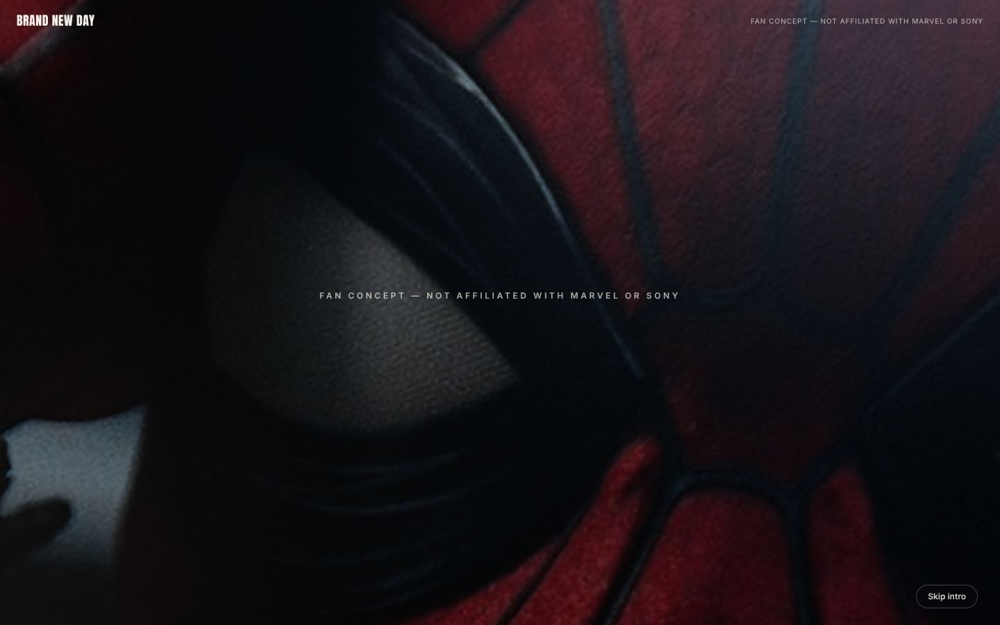

**Português** | [English](README.md)

# Spider-Man: Brand New Day — Site conceitual de fã

> **Tipo:** site conceitual fan-made, não comercial (sem link de demo publicado).
>
> **Projeto de fã não oficial.** **Não tem afiliação, endosso nem produção da Marvel,
> Sony Pictures ou Disney.** Homem-Aranha e todos os personagens, nomes, imagens e marcas
> relacionados pertencem aos respectivos donos. Nenhum logo oficial é usado como marca do
> site; o título da navegação é texto simples.



Site de uma página, cinematográfico e guiado pela rolagem, construído em torno da
campanha promocional de *Spider-Man: Brand New Day* (estreia nos cinemas indicada no
texto do site como **31 de julho de 2026**). Abre com uma sequência 3D de "mergulho" —
um close no olho da máscara que se afasta até um diorama 2.5D de Nova York com o
Homem-Aranha balançando em teias — e então passa para uma narrativa tradicional em DOM:
painéis de quadrinhos, galeria de vilões, trailer incorporado e linha do tempo da era Tom
Holland.

## Funcionalidades

- **Ato 1 (WebGL):** close no olho → mergulho em paralaxe 2.5D por NYC com teias/poeira
  → transição em retícula (halftone) para o conteúdo DOM, com botão "Skip intro" e versão
  estática para movimento reduzido.
- **Ato 2 (DOM):** Story (painéis fixados), Threats (vilões com transições), Watch
  (trailer carregado só ao clicar + galeria), Legacy (linha do tempo em faixa horizontal)
  e botão "compartilhar".
- Aviso de projeto de fã no selo da navegação, no rodapé e na meta description.

## Stack

- **[Next.js 16](https://nextjs.org)** (App Router, Turbopack) + **React 19** + TypeScript
- **[React Three Fiber](https://docs.pmnd.rs/react-three-fiber)** + **drei** + **three.js**
  — canvas do Ato 1
- **[GSAP](https://gsap.com) + ScrollTrigger** — todas as sequências fixadas/sincronizadas
  com a rolagem
- **[Lenis](https://lenis.darkroom.engineering)** — rolagem suave, sincronizada com o
  ScrollTrigger
- **Tailwind CSS v4**
- **[sharp](https://sharp.pixelplumbing.com)** — pipeline offline de imagens;
  **Playwright** — scripts locais de captura (apenas desenvolvimento)

O Canvas (three.js/R3F/drei) é carregado separadamente via
`next/dynamic({ ssr: false })` para não bloquear a primeira pintura nem inflar o bundle
inicial.

## Como rodar

Pré-requisitos: Node.js 20+ e npm. Não há variáveis de ambiente.

```bash
npm ci
npm run dev        # http://localhost:3000
```

Para conferir o comportamento de produção (o servidor de desenvolvimento se comporta
diferente, principalmente no carregamento do Canvas e na otimização de imagens):

```bash
npm run build
npm run start
```

> **Nota sobre Windows:** `next dev` com Turbopack foi instável no ambiente do autor (pode
> travar). Prefira `npm run build && npm run start` para verificar o comportamento real.

### Scripts

| Script | Descrição |
| --- | --- |
| `npm run dev` | Servidor de desenvolvimento |
| `npm run build` | Build de produção |
| `npm run start` | Serve o build de produção |
| `npm run lint` | ESLint |

## Pipeline de imagens

As imagens processadas em `public/media/` **estão versionadas**, então um clone novo
funciona sem passos extras. As fontes originais (`assets-raw/`) **não** são versionadas
de propósito (são imagens promocionais de terceiros e são grandes).

Para regenerar `public/media/`:

1. Coloque suas próprias imagens de origem em `assets-raw/` (veja em
   `scripts/prepare-media.mjs` os nomes esperados e em `src/lib/media.ts` o manifesto
   lido pelo site).
2. Rode:

   ```bash
   node scripts/prepare-media.mjs
   ```

   O script redimensiona/recorta/recodifica cada imagem com `sharp`, gera o mapa de
   normais (Sobel) do olho do Ato 1, recorta a silhueta do Homem-Aranha e produz as
   versões menores usadas em dispositivos de toque.

`scripts/capture*.mjs` são scripts Playwright usados no desenvolvimento para capturas
locais (saída em `shots*/`, ignorada pelo git).

## Créditos e direitos das imagens

- **Fotos de personagens, pôsteres e artes** em `public/media/` são material promocional
  oficial de *Spider-Man: Brand New Day* (segundo o autor, obtido do espelho de press kit
  do TMDB e de fotos de divulgação) mais pôsteres de *Homecoming*, *Far From Home* e
  *No Way Home* usados na linha do tempo. Vários desses pôsteres contêm o logotipo oficial
  do título dos filmes. © Marvel / Sony Pictures / Disney. **Nenhuma licença foi
  obtida**; são usados apenas neste tributo de fã não comercial e serão removidos a
  pedido dos detentores dos direitos. Um card de vilão (Tombstone) usa um recorte tratado
  de pôster como alternativa.
- **Fotografias de Nova York** (as cinco camadas de paralaxe do Ato 1) são do
  [Unsplash](https://unsplash.com):
  - `nyc-1` — Manhattan aérea à noite, [Andre Benz](https://unsplash.com/@trapnation)
  - `nyc-2` a `nyc-5` — skyline/ruas; fotógrafos individuais não documentados
- **Trailer:** incorporado via `youtube-nocookie.com`, carregado só ao clicar. O vídeo
  nunca é rehospedado nem baixado — nenhuma requisição ao YouTube é feita até o clique.
- A captura acima (`docs/screenshots/home.jpg`) foi feita do build local.

## Estrutura

```
src/
  app/                  Entrada do App Router (layout, page, globals.css)
  components/
    act1/               Canvas R3F: olho, mergulho em NYC, teias/poeira, transição halftone
    act2/               Seções DOM: Story, Threats, Watch, Legacy
    nav.tsx, footer.tsx Navegação e rodapé (o aviso aparece em ambos e na meta description)
  lib/
    content.ts          Todo o texto exibido, centralizado (só em inglês)
    media.ts            Manifesto das imagens (caminhos em public/media/)
    act1-store.ts       Estado compartilhado do progresso de rolagem do Ato 1
public/media/           Imagens processadas usadas pelo site
scripts/
  prepare-media.mjs     Pipeline de imagens (sharp)
  capture*.mjs          Scripts Playwright de captura usados no desenvolvimento
```

## Regras do projeto

- Todo texto exibido ao usuário fica em inglês e centralizado em `src/lib/content.ts`.
- Vídeos do filme nunca são rehospedados — o trailer é só um embed `youtube-nocookie.com`.

## Limitações

- Experimento pessoal de fã/portfólio; não se destina a uso comercial nem a ser
  publicado como site oficial.
- Depende de imagens promocionais de terceiros (ver acima).
- Sem testes automatizados; a CI roda apenas lint e build.

## Segurança

Veja [SECURITY.md](SECURITY.md).

## Licença

Ainda não há licença definida; todos os direitos reservados ao autor. Isso vale apenas
para o código próprio do autor — personagens, imagens e marcas de terceiros continuam
pertencendo aos respectivos donos.
